# 🛒 Sistema de Gestión de Tienda (Consola)

¡Bienvenido al proyecto de tienda por terminal! Esta es una aplicación de comercio electrónico en **Java puro (sin dependencias externas)**, desarrollada como práctica de Programación (2º DAW). Su objetivo es demostrar el dominio de la **Programación Orientada a Objetos (POO)**, uso avanzado de colecciones, patrón MVC y manipulación de archivos.

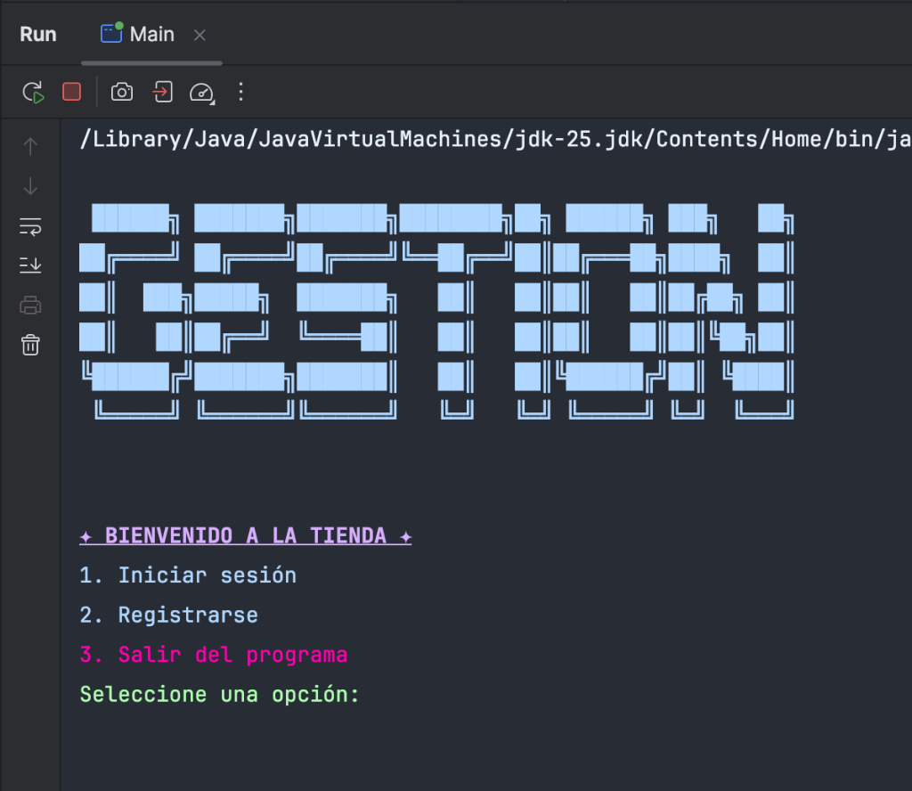

## 🛠 Arquitectura y Decisiones de Diseño

El sistema está estructurado bajo un **Patrón MVC estricto (Modelo - Vista - Controlador)**, garantizando que el código sea mantenible, limpio y escalable:

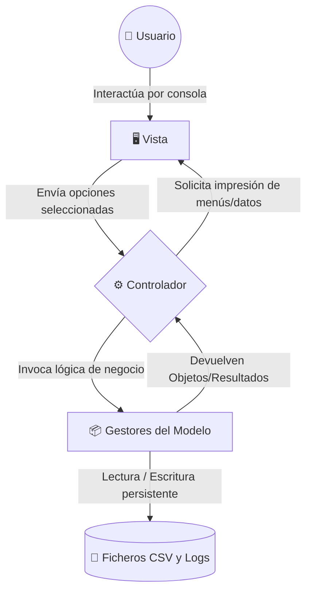

La estructura física del proyecto refleja claramente este patrón:

```text
src/main/java/
├── Main.java                          # Punto de entrada de la aplicación
│
├── controlador/                       # Lógica de control y coordinación
│   └── Controlador.java               # Flujos diferenciados por rol (Admin y Cliente)
│
├── vista/                             # Interfaz de usuario (Consola)
│   └── Vista.java, Estilos.java       # Menús, tablas tabuladas y colores ANSI
│
├── modelo/                            # Entidades de dominio y gestión de datos
│   ├── Producto.java, Pedido.java, Usuario.java, Carrito.java...
│   ├── GestionProducto.java, GestionPedido.java, GestionUsuario.java...
│   │
│   └── utilidades/                    # Servicios transversales y persistencia
│       └── GestorCSV.java, GestorLogs.java, FuncionesPrecios.java, Cadenas.java
```

1. **La Vista (`Vista.java`)**: Es la *única* clase que contiene `System.out.println` o lee datos por consola. Se encarga de toda la interfaz y de usar colores y formatos ANSI para mejorar la experiencia de usuario (UX). No procesa ninguna lógica de negocio.
2. **El Controlador (`Controlador.java`)**: Es el cerebro central. Invoca a la Vista para mostrar opciones, lee las peticiones del usuario y se comunica con los gestores del Modelo para realizar acciones (separando lógicamente el flujo según el rol).
3. **El Modelo (`Gestion*`)**: Se encarga de manipular y persistir los datos puros.

### 🛡️ Manejo de Excepciones (Robustez)
El programa ha sido diseñado para no detenerse (*crash*) ante errores imprevistos, gestionando las excepciones en dos frentes principales:
- **Errores de Entrada del Usuario (I/O)**: Cuando la Vista solicita un número (ej. menú o cantidades), se controla mediante la captura de `InputMismatchException` o parseos seguros con `NumberFormatException`. Si el usuario introduce una letra donde va un número, el sistema se lo notifica amigablemente y le vuelve a pedir el dato, evitando la finalización abrupta del programa.
- **Corrupción de Ficheros**: A la hora de leer los ficheros `.csv` (en los `Gestores`), el parseo de cada línea está envuelto en un bloque `try-catch (RuntimeException)`. Si alguien modifica el fichero a mano e introduce una línea corrupta, el sistema la ignora limpiamente y continúa cargando el resto de los datos válidos.

### 🧬 Polimorfismo y Clases
- **Productos**: Existe una clase abstracta `Producto` de la cual heredan `ProductoFisico` (que tiene atributos concretos como peso) y `ProductoDigital` (que incluye el manejo de licencias).
- **Usuarios**: Se ha diseñado una jerarquía robusta con la clase abstracta `Usuario`, que se divide en `UsuarioCliente` y `UsuarioAdmin`, permitiendo gestionar permisos de forma natural y escalable.

### 📚 Colecciones Utilizadas
Se han seleccionado las estructuras de datos óptimas para cada necesidad:
- **`HashMap`**: Utilizado para almacenar Productos y Usuarios en memoria. Permite acceder a cualquier elemento en tiempo constante de forma súper rápida buscando por ID o por Email.
- **`LinkedHashMap`**: Utilizado en el `Carrito` de compras. A diferencia del HashMap clásico, preserva el **orden de inserción**, de modo que los productos aparecen en la factura exactamente en el orden en que el usuario los añadió.
- **`ArrayList`**: Utilizado de forma general para listados, historiales y para volcar datos a los CSV de forma sencilla.

---

## ⭐ Extra Elegido: Login, Roles y Registro de Actividad

Como funcionalidad extra de la práctica, he decidido implementar un sistema de usuarios:

- **Menús dinámicos por rol**: Al iniciar sesión, el programa detecta si eres Administrador o Cliente. Si eres cliente, te muestra solo las opciones de compra; si eres administrador, te muestra las opciones de gestión. Así evitamos mostrar menús que el usuario no puede usar.
- **Bloqueo de seguridad**: Si alguien introduce mal su contraseña 3 veces seguidas, su cuenta queda inactiva (bloqueada) por seguridad. El administrador puede volver a activarla desde su menú.
- **Registro de actividad (Logs)**: Para tener un control de lo que pasa en la tienda, he añadido un pequeño archivo `registro_actividad.log` donde se guardan de fondo algunas acciones importantes (como cuándo entra un usuario, compras nuevas o bloqueos de cuenta).

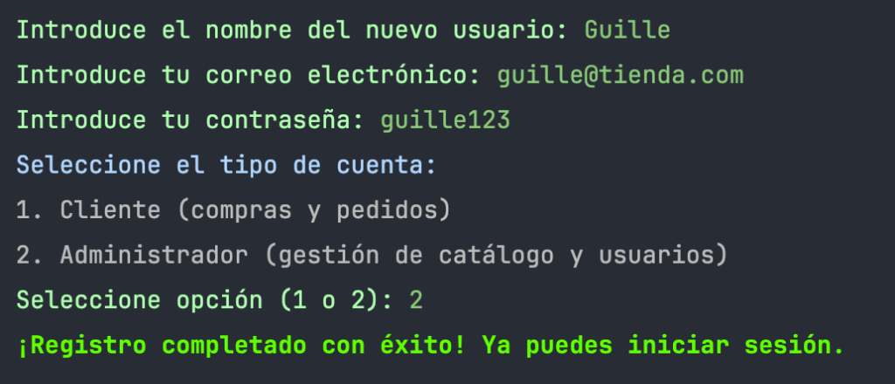

---

## 📸 Tour Visual del Sistema

### 1. El Backoffice: Modo Administrador 🛡️
El Administrador tiene el control absoluto. Puede gestionar el catálogo de productos y los usuarios de la plataforma.

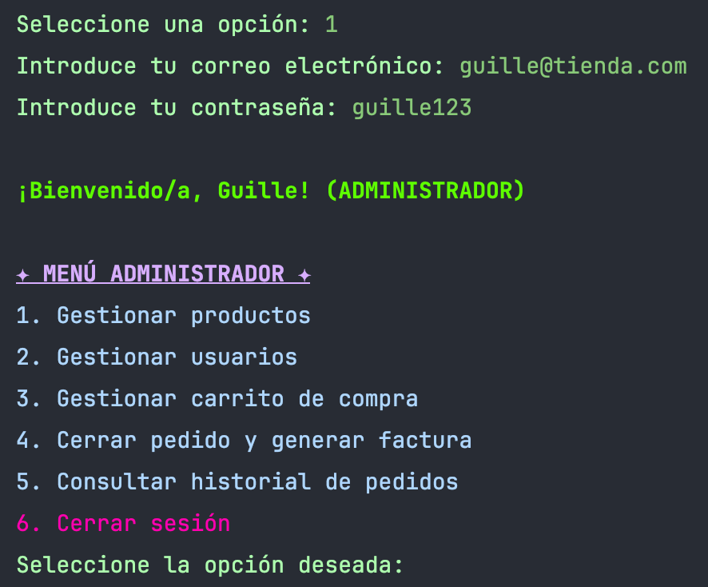
<p align="center"><i>Al acceder, el Administrador tiene su propio menú exclusivo de 6 opciones.</i></p>

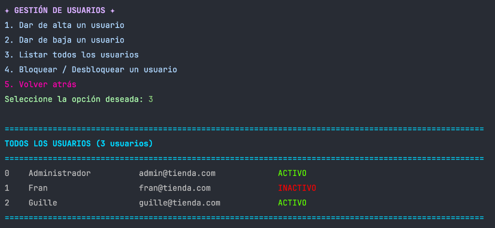
<p align="center"><i>Listado general de usuarios. Se aprecia visualmente con colores (rojo/verde) el estado de cada cuenta.</i></p>

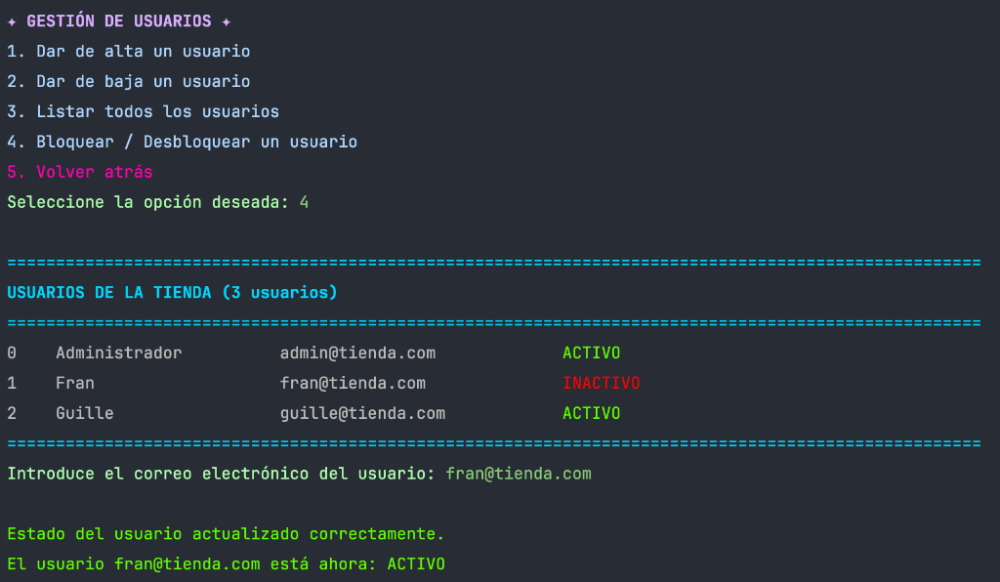
<p align="center"><i>El administrador puede <b>Desbloquear</b> cuentas suspendidas o bloquear usuarios problemáticos en un solo paso, invirtiendo su estado de forma dinámica.</i></p>

### 2. La Experiencia de Compra: Modo Cliente 🛍️
Cuando un cliente inicia sesión, su entorno es limpio y directo al grano: comprar.

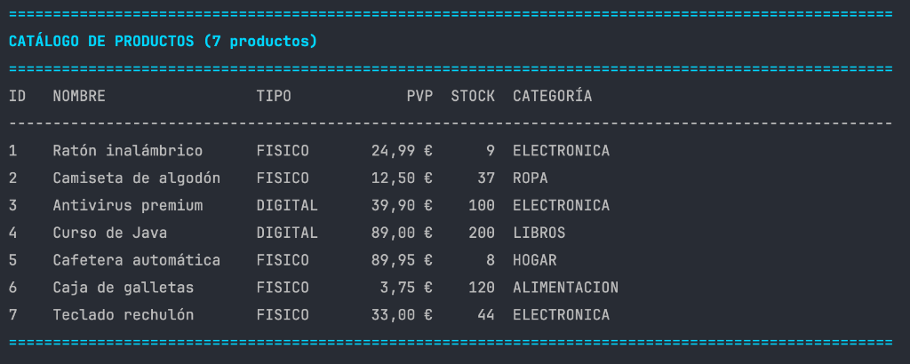

El cliente puede navegar por el catálogo completo de la tienda, listando los productos físicos y digitales:

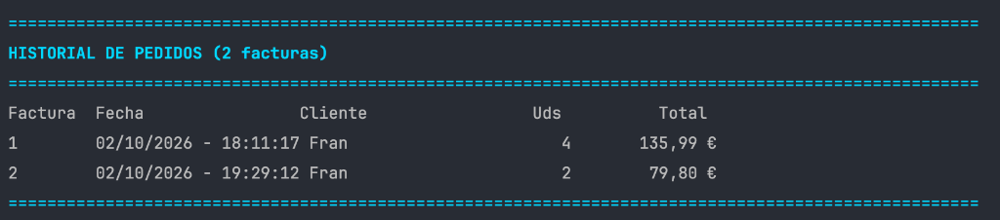
<p align="center"><i>Catálogo tabulado de forma inteligente y automática.</i></p>

Puede buscar productos filtrando por categoría o presupuesto:
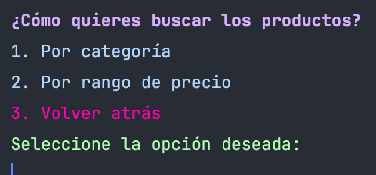

Tras añadir productos, el carrito de compra le desglosa subtotales y unidades en tiempo real:
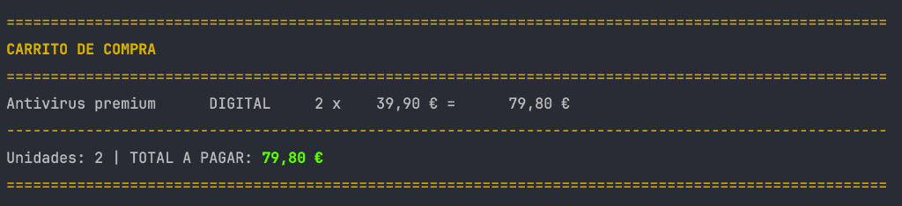

Al tramitar el pedido, se solicita confirmación interactiva para evitar errores:
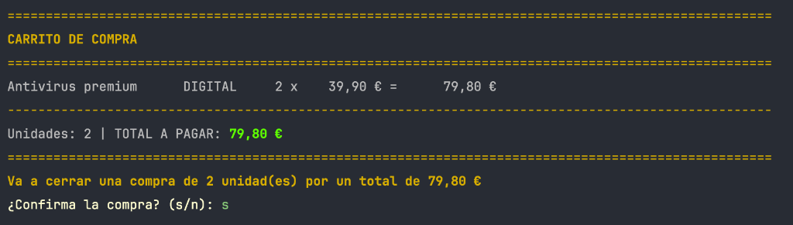

Si la compra se concreta, el sistema vacía la cesta y genera automáticamente una **Factura detallada** que se almacena en el sistema y se muestra en pantalla:
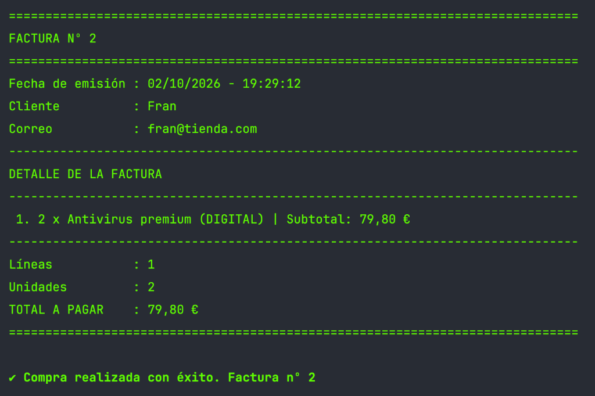

Por último, tanto el cliente (sus propios pedidos) como el administrador (los pedidos de toda la tienda) pueden consultar el historial global de operaciones generadas:
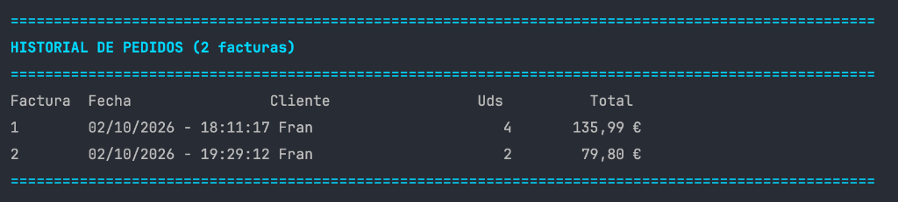

---

## 🚀 Cómo Ejecutar el Proyecto

Para arrancar la tienda y probarla tú mismo, puedes hacerlo de dos formas muy sencillas:

**Opción A: Desde un entorno de desarrollo (IDE como IntelliJ, Eclipse o VSCode)**
1. Abre la carpeta del proyecto (`Pre_backend_Java`) en tu IDE.
2. Localiza el archivo `Main.java` (dentro de `src/main/java/`).
3. Haz clic derecho sobre él y selecciona **Run 'Main.main()'**.

**Opción B: Desde la Terminal (por comandos)**
1. Abre tu terminal o consola de comandos.
2. Navega hasta la carpeta del proyecto (donde está el archivo `pom.xml`).
3. Compila el código escribiendo:
   ```bash
   mvn compile
   ```
4. Inicia la aplicación ejecutando:
   ```bash
   java -cp target/classes Main
   ```

¡Y listo! Ya puedes disfrutar de la tienda.
